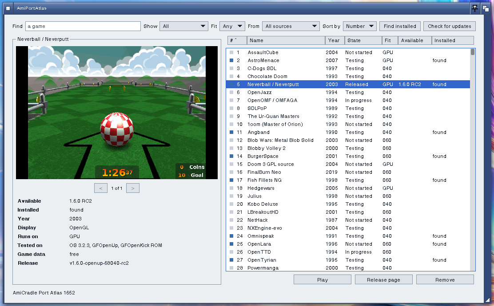
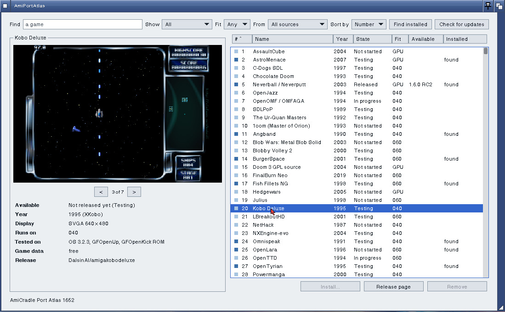
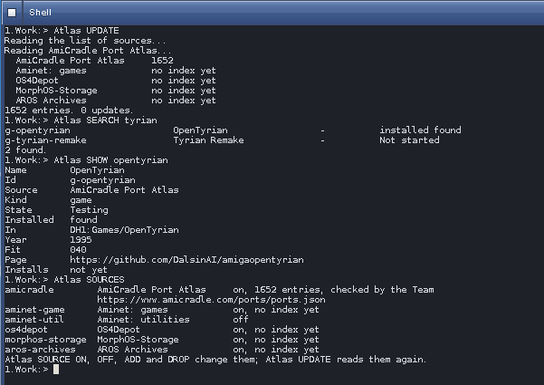

# AmiPortAtlas

**Every Amiga game and program we know of, in one window.**

AmiPortAtlas is the app store your Amiga never had. Open it and the whole
AmiCradle Port Atlas is there: more than 1,600 games and programs, with
their pictures, what they need and how far along each port is. Pick one,
click **Install...**, and it downloads, checks and installs itself, ready to
play. When a new version comes out, AmiPortAtlas tells you and updates it
in one click.

And it doesn't stop at our own ports. Like APT on Linux, AmiPortAtlas reads
**sources**: the Port Atlas, the sources in our master list (Aminet,
OS4Depot, MorphOS-Storage, AROS Archives as their readers arrive) and any
source you add yourself. They all show up as one list you can search, sort
and filter.

For the Shell, there's **Atlas**: `Atlas UPDATE`, `Atlas SEARCH`,
`Atlas INSTALL`, `Atlas UPGRADE`, the commands you'd expect from a package
manager, on a 68040. Made something yourself? `Atlas PUBLISH` puts it in
your own source over FTP or FTPS, and can send it to Aminet too.







[docs/HOWTO.md](docs/HOWTO.md) shows how to install it and use it.

## What it needs

| | AmigaOS 3.2.3 / GFOS | AROS | AmigaOS 4.1 |
| --- | --- | --- | --- |
| Window | GFOpenLayout UI (linked in), in the GFOpenGadTools theme | the same | the same |
| Network | a TCP/IP stack (bsdsocket.library) | its stack | Roadshow |
| HTTPS | gfopentls.library (GFOpenUp) | gfopentls.library | gfopentls.library |
| Unpacking | SYS:Utilities/OpenCompress, else C:LhA | the same | C:LhA |
| Installing | SYS:System/Installer 43.3 or newer | the same | the same |

The games in the Atlas are 68k programs for AmigaOS 3, so they install on
3.2.3, GFOS and AROS m68k. On AROS x86 and AmigaOS 4.1, AmiPortAtlas lists
everything and opens the release pages; a game installs there once the
Atlas carries a build for that system.

## Sources

AmiPortAtlas reads several sources, as APT does: the Port Atlas, and others
from a master list kept in this repository (`data/sources.json`), plus any
the player adds. It shows them as one list, finds updates in each, and has a
Shell command, `Atlas`, for all of it (`Atlas UPDATE`, `Atlas INSTALL`,
`Atlas UPGRADE`...), and `Atlas PUBLISH` to put a new archive into your own
source by FTP or FTPS. [docs/SOURCES.md](docs/SOURCES.md) has it all.

## Where the Port Atlas comes from

`https://www.amicradle.com/ports/ports.json`, made from the Port Atlas in
[DalsinAI/amicradle](https://github.com/DalsinAI/amicradle) (`docs/porting`).
The website's Port Atlas page reads the same file, so the two always agree.
[docs/FEED.md](docs/FEED.md) has the fields. A copy is kept in
`PROGDIR:Cache` for when the network is down, with every other source's.

## Building

```
make test                 host tests: the feed reader, SHA-256 and the real window
make render               the window drawn on the host as build/window.png
make os3                  AmigaOS 3.2.3 and GFOS (68040, soft float): AmiPortAtlas and Atlas
./build-amiga.sh          the same with a stove, fetching what it builds on
```

The Makefile's head names what each needs: a DalsinAI/gfopenlayout
checkout (`OLUI`), GFOpenGadTools' theme reader (`OGT`), GFOpenTLS's
headers (`TLS_INC`). The AROS and AmigaOS 4.1 builds follow once
GFOpenLayout UI's glue and GFOpenTLS are built there.

## Licence

MIT. Designed, tested and delivered by The AmiCradle Team.
